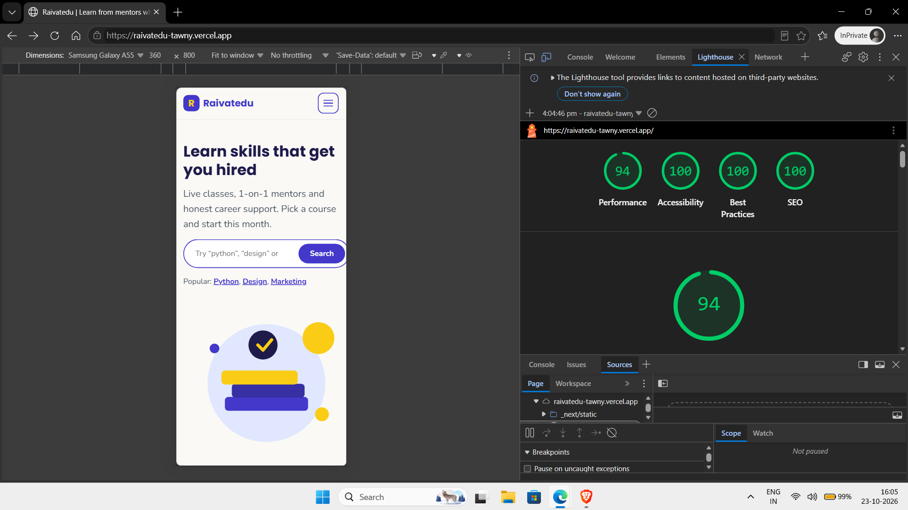

**Live site:** https://raivatedu-tawny.vercel.app
**Repo:** https://github.com/sanket-ghayal/raivatedu

## Lighthouse (mobile)
Measured with Lighthouse in Chrome DevTools (mobile emulation) on the live Vercel link.
Performance 94 · Accessibility 100 · Best Practices 100 · SEO 100



# Raivatedu: Education Marketing Website☻

A 3-page marketing site built with Next.js (App Router), JavaScript and CSS Modules.
Pages: Home, Courses listing (`/courses`), Course detail (`/courses/[slug]`).

## Run locally
```bash
npm install
npm run dev      # http://localhost:3000
npm run build    # production build check
```
Requires Node.js 18.18 or newer.

## Deploy (Vercel)
Push to GitHub, import the repo at vercel.com, click Deploy. No settings needed.

## Folder structure
- `app/`: routes, layout, global CSS tokens
- `components/`: Navbar, Footer, Button, CourseCard, Accordion, CourseExplorer, EnrolCard, SearchBar
- `data/content.js`: all courses, mentors, FAQs and copy
- `lib/format.js`: price formatter

## Design decisions
- **Colours:** indigo `#4338ca` (trust), sunny yellow `#facc15` (youthful energy), off-white `#faf9f6` (soft, easy on eyes). Tokens live in `app/globals.css`.
- **Fonts:** Poppins (rounded, friendly headings) and Nunito (readable body), loaded with `next/font`.
- **Styling:** CSS Modules per component plus CSS variables for colour, type scale and spacing.
- **Motion:** a soft hero entrance and an animated accordion. All motion is disabled under `prefers-reduced-motion`.
- **Accessibility:** semantic landmarks, one `h1` per page, labelled inputs, keyboard-usable menu and accordion, visible focus rings.

## Assumptions
- Courses, prices (INR), mentors and reviews are invented sample data.
- Images are an original SVG illustration and emoji icons, so no external image hosts are needed.
- The enrol button and search are front-end only. No backend.

## What I would improve with more time
- Real photography for mentors, dark mode toggle, page transitions
- Persist filters in the URL, add a reviews pagination and a payment-plan modal
